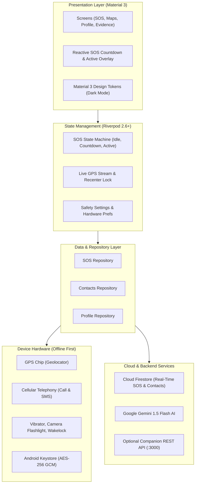

<div align="center">

# 🛡️ Nirbhaya (निर्भया)
### Women's Safety & Emergency Assistance Platform
##### Sole Creator & Developer: **[Aman Kanojiya](https://codedbyamankanojiya.vercel.app)**

[](https://flutter.dev)
[](https://dart.dev)
[](https://firebase.google.com)
[](https://aistudio.google.com)
[](docs/MANUAL_SETUP_GUIDE.md)
[](#-quick-start-guide)
[](docs/SECURITY.md)

*A production-ready, life-critical personal safety ecosystem engineered to deliver rapid emergency distress dispatch, real-time geolocated threat mapping, covert audio/video evidence capture, and intelligent crisis assistance.*

---

[Key Features](#-key-features) •
[Architecture](#-system-architecture) •
[Quick Start](#-quick-start-guide) •
[Firebase & AI Setup](#-firebase--gemini-ai-configuration) •
[Security & Zero-Leak Policy](#-security--zero-leak-policy) •
[Contributing](#-contributing)

---

</div>

## 🌟 Key Features

### 🚨 Emergency Response & SOS System
- **One-Touch SOS Activation**: High-visibility distress button with configurable safety countdown (1s–10s) and haptic pulsing.
- **Fail-Safe Cancellation & "I'm Safe"**: Instantly halts all background countdown timers, silences emergency vibrations, releases the screen wakelock, and synchronizes status to `RESOLVED` or `FALSE_ALARM`.
- **Hardware Integration**: High-frequency strobe flashlight, dual-tone alarm siren, screen wakelock, and multi-pattern vibrations.
- **Offline Hardware Dispatch**: Immediately dials emergency numbers (112 ERSS, 1091 Women Helpline) and sends emergency SMS with precise GPS coordinates directly through native device telephony.

### 🗺️ Live Safety Map & Real-Time Tracking
- **Continuous High-Accuracy GPS**: Live `Geolocator.getPositionStream` with pulsing animated radar marker and compass heading.
- **OpenStreetMap (100% Free & Open Source)**: Zero dependency on paid Google Maps APIs or billing accounts.
- **Emergency Safe Havens Discovery**: Discovers nearby Police Stations, Hospitals, Fire Stations, and Women Shelters with single-tap routing.

### 👥 Emergency Contacts & Priority Badges
- **Guardian Prioritization**: Organize contacts with primary priority badges (`★ PRIMARY GUARDIAN`) and relationship categories (`Parent`, `Spouse`, `Sibling`, `Friend`, `Guardian`, `Doctor`, `Police`).
- **Single-Tap Calling & SMS**: Instant cell call or pre-formatted SOS distress text dispatch.
- **Dual-Layer Persistence**: Stored locally in `SharedPreferences` for offline access AND synchronized to Cloud Firestore (`users/{uid}/contacts`).

### 👤 Comprehensive Medical & Profile Card
- **Medical Emergency Data**: Records Blood Group, Allergies, Pre-existing Conditions, Primary Physician, and Medical Notes.
- **Emergency Identifiers**: Government ID / Aadhaar verification, Emergency Code, and Vehicle Number.
- **Distress Interlink**: Medical and personal profile data automatically attaches to emergency SOS distress payloads.

### 📹 Covert Evidence Studio & Vault
- **Multi-Mode Capture**: Instant Photo Capture, Video Capture, and Stealth Audio Recording.
- **Covert Audio Mode**: Real-time recording timer, live audio waveform visualizer, and an OLED Blackout Screen to prevent detection.
- **Secure Sandboxed Vault**: Stored in isolated device storage before optional cloud backup.

### 🤖 Intelligent AI Safety & Legal Assistant
- **Google Gemini 1.5 Flash**: Real-time crisis guidance and threat de-escalation powered by Google Gemini AI.
- **Offline Indian Legal Rights Engine**: Built-in comprehensive rules engine answering questions on **Zero FIR**, **POCSO Act**, **POSH Act**, **Domestic Violence Act**, and police procedures without needing an internet connection.

### 📚 Dedicated Helpline Directory & Safety Guides
- **Emergency Directory**: Single-tap direct dialing to 112 (ERSS), 1091 (Women Helpline), 181 (Domestic Abuse), 1930 (Cyber Crime), 100 (Police), 1098 (Childline), and NCW.
- **Interactive Action Guides**: Step-by-step checklists for Combat Readiness, Cab/Travel Safety, Stalking Protection, and Legal Rights.

---

## 🏗️ System Architecture

Nirbhaya is engineered using a clean, feature-first, domain-driven architecture built on **Flutter Riverpod 2.6+** and **Material 3**:



---

## 🚀 Quick Start Guide

### 1. Prerequisites
- **Flutter SDK**: `^3.24.0` or higher ([Install Flutter](https://docs.flutter.dev/get-started/install))
- **Dart SDK**: `^3.5.0`
- **Android Studio / VS Code** with Flutter and Dart extensions
- **Android Device / Emulator** (API 26+ / Android 8.0+)

Verify your environment:
```bash
flutter doctor -v
```

### 2. Clone and Install Dependencies
```bash
git clone https://github.com/codedbyamankanojiya/Nirbhaya.git
cd Nirbhaya

# Install Flutter dependencies
flutter pub get
```

### 3. Setup Local Configuration
Copy the template configuration:
```bash
cp .env.example .env
```

---

## ⚙️ Firebase & Gemini AI Configuration

### A. Firebase Cloud Setup (Optional for Cloud Sync)
The app is designed with an **offline-first fallback engine**. Cloud database sync is optional:
1. Register your Android app on [Firebase Console](https://console.firebase.google.com/) with package name:
   ```text
   com.nirbhaya.nirbhaya
   ```
2. Enable **Firestore Database** and **Authentication** (Email/Password & Anonymous).
3. Download `google-services.json` and place it in:
   ```text
   android/app/google-services.json
   ```
4. Or configure automatically via FlutterFire:
   ```bash
   dart pub global activate flutterfire_cli
   flutterfire configure
   ```

### B. Google Gemini AI Key
1. Get a free API key from [Google AI Studio](https://aistudio.google.com/).
2. You can configure it in three ways:
   - **In-App (Instant)**: Open app $\rightarrow$ **Settings** $\rightarrow$ **Google Gemini AI Key** $\rightarrow$ Paste key and save.
   - **Launch Flag**: Run with `--dart-define=GEMINI_API_KEY=your_key`.
   - **Local `.env`**: Add `GEMINI_API_KEY="your_key"` to your local `.env` file.

---

## 🔒 Security & Zero-Leak Policy

To prevent accidental leaks of sensitive personal information or API credentials when pushed to public GitHub repositories:

1. **Strict `.gitignore`**: All `.env`, `google-services.json`, `GoogleService-Info.plist`, `firebase_options.dart`, `*.keystore`, and `key.properties` are strictly excluded from version control.
2. **Zero Hardcoded Secrets**: No API keys or tokens exist in plain text inside the tracked Dart codebase.
3. **Hardware Keystore Storage**: All authentication tokens and safety PINs are encrypted using hardware-backed **AES-256 GCM** in the Android Keystore.
4. **Sandboxed Media**: Evidence recordings are saved in private sandboxed application storage.

For detailed security policies, vulnerability reporting, and encryption standards, please see **[SECURITY.md](docs/SECURITY.md)**.

---

## 🧪 Testing & Code Quality

Run the test suite:
```bash
# Run unit & state machine tests
flutter test

# Run static analysis
flutter analyze
```

---

## 📦 Building for Production

### Android Release APK
```bash
flutter build apk --release --split-per-abi
```
Outputs: `build/app/outputs/flutter-apk/app-arm64-v8a-release.apk`

### Google Play App Bundle (AAB)
```bash
flutter build appbundle --release
```
Outputs: `build/app/outputs/bundle/release/app-release.aab`

---

## 🤝 Contributing

Contributions are welcome! Please review:
- 📜 **[Code of Conduct](docs/CODE_OF_CONDUCT.md)**
- 🤝 **[Contributing Guidelines](docs/CONTRIBUTING.md)**
- 🛡️ **[Security Policy](docs/SECURITY.md)**
- 📖 **[Manual Setup Guide](docs/MANUAL_SETUP_GUIDE.md)**

---

## 👨‍💻 Sole Creator & Developer

**Nirbhaya** is conceptualized, designed, architected, and developed solely by:

**Aman Kanojiya**  
*Full Stack & Mobile Engineer — Creator of Nirbhaya*

- 🌐 **Portfolio**: [codedbyamankanojiya.vercel.app](https://codedbyamankanojiya.vercel.app)
- 🐙 **GitHub**: [@codedbyamankanojiya](https://github.com/codedbyamankanojiya)
- 💼 **LinkedIn**: [Aman Kanojiya](https://www.linkedin.com/in/aman-kanojiya-7386822b0)
- 🐦 **Twitter (X)**: [@AKnj08](https://x.com/AKnj08)

---

## 📄 License

Copyright (c) 2026 Aman Kanojiya. All rights reserved.  
All rights, title, architecture, code, and intellectual property of the Nirbhaya platform belong exclusively to Aman Kanojiya. See the [LICENSE](LICENSE) file for terms.
