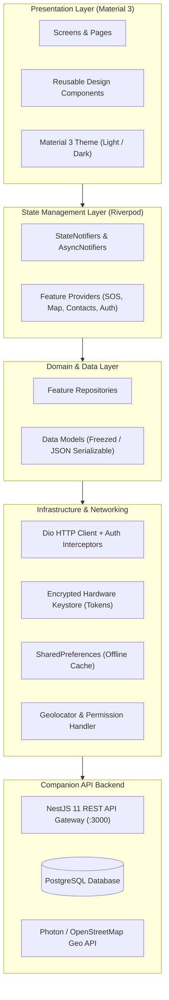

<div align="center">

# 🛡️ Nirbhaya (निर्भया)
### Women's Safety & Emergency Assistance Platform

[](https://flutter.dev)
[](https://dart.dev)
[](docs/architecture.md)
[](#running-the-application)
[](LICENSE)

*A production-ready, cross-platform personal safety ecosystem engineered to deliver rapid emergency distress dispatch, real-time geolocated threat mapping, live journey tracking, and discreet de-escalation tools.*

---

[Key Features](#-key-features) •
[Architecture](#-system-architecture) •
[Quick Start](#-quick-start-guide) •
[Configuration](#-environment-configuration) •
[Project Structure](#-project-structure) •
[Documentation](#-comprehensive-documentation)

---

</div>

## 🌟 Key Features

### 🚨 Emergency Response & SOS System
- **One-Touch SOS Activation**: High-visibility distress button with optional safety countdown to prevent accidental triggers.
- **Real-Time GPS Location Broadcast**: Instantly captures precise latitude and longitude coordinates and transmits distress payloads to the backend API.
- **Hardware Trigger Support**: Haptic feedback alerts with wakelock protection to prevent phone lock during an active distress state.
- **Two-Way Status Synchronization**: Seamlessly updates distress statuses between `TRIGGERED`, `CANCELLED` (false alarm), and `RESOLVED` directly with the backend.

### 🗺️ Live Safety Map & Verified Safe Havens
- **Live Location Tracking**: Interactive OpenStreetMap interface using `flutter_map` and `latlong2`.
- **Live Safety POI Discovery**: Real-time geolocation lookup via OpenStreetMap / Photon geocoding engine discovering nearby:
  - 🚓 **Police Stations & Beats**
  - 🏥 **Hospitals & 24/7 Emergency Care**
  - 🚒 **Fire Stations**
  - 🏠 **Designated Women Shelters & Safe Havens**
- **Direct Navigation & Dialing**: Single-tap dialing and route calculation to any discovered emergency point.

### 👥 Emergency Contacts & Fast Dispatch
- **Priority Contact Ordering**: Configure primary and secondary emergency contacts with relationship indicators.
- **Native Dialing & SMS Hand-off**: Immediate one-tap cellular dialing via native `url_launcher`.
- **Cloud & Local Synchronization**: Contacts are cached locally using `SharedPreferences` for guaranteed offline availability during network drops.

### ⚠️ Incident Reporting & Community Risk Alerts
- **GPS-Tagged Incident Creation**: Log incidents with real-time geographic coordinates, category classification (e.g. Harassment, Stalking, Suspicious Activity, Poor Lighting), and severity ratings.
- **Evidence Attachment**: Integrated camera and media picker for instant photo and evidence capture.
- **Community Threat Awareness**: Browse live geotagged incidents to remain informed of high-risk zones.

### 🎭 De-Escalation & Covert Tools
- **Realistic Fake Call Simulator**: Configurable simulated incoming call interface complete with custom caller names, realistic ringing, screen vibration, and interactive call answering to safely escape uncomfortable or threatening situations.
- **Evidence & Audio Capture**: Dispatched recording utilities for capturing audio evidence during distress situations.
- **Offline Safety Guidelines**: Comprehensive pre-loaded safety tips, self-defense tactics, and legal rights resources.

### 📞 National Helplines Directory
- Instant direct-dial access to national emergency numbers:
  - **112**: All-in-One National Emergency Response Support System (ERSS)
  - **1091**: Women Helpline (24x7 Emergency Assistance)
  - **100**: Police Control Room
  - **181**: Domestic Abuse & Violence Helpline
  - **1098**: Childline Support

---

## 🏗️ System Architecture

Nirbhaya is engineered using a clean, feature-first, domain-driven layered architecture built on **Riverpod 2.6+** and **GoRouter 14.8+**.



### Technology Stack

| Layer | Technologies |
| :--- | :--- |
| **Framework** | [Flutter 3.5+](https://flutter.dev) (Channel: Stable) |
| **Language** | [Dart 3.5+](https://dart.dev) |
| **State Management** | [Flutter Riverpod 2.6.1](https://pub.dev/packages/flutter_riverpod) |
| **Navigation & Routing** | [GoRouter 14.8.1](https://pub.dev/packages/go_router) |
| **Networking** | [Dio 5.7.0](https://pub.dev/packages/dio) with JWT silent refresh interceptors |
| **Hardware Secure Storage** | [flutter_secure_storage 9.2.4](https://pub.dev/packages/flutter_secure_storage) (Android Keystore / iOS Keychain) |
| **Mapping & Geolocation** | [flutter_map 7.0.2](https://pub.dev/packages/flutter_map), [latlong2 0.9.1](https://pub.dev/packages/latlong2), [geolocator 13.0.2](https://pub.dev/packages/geolocator) |
| **UI & Styling** | Material Design 3, [Google Fonts (Inter)](https://pub.dev/packages/google_fonts), [flutter_animate](https://pub.dev/packages/flutter_animate) |
| **Companion Backend** | [NestJS 11](https://nestjs.com), [Prisma 7 ORM](https://www.prisma.io), [PostgreSQL](https://www.postgresql.org) |

---

## 📁 Project Structure

The project strictly follows a domain-driven, feature-first structure:

```
nirbhaya/
├── android/                            # Native Android Gradle configuration
├── ios/                                # Native iOS Xcode configuration
├── web/                                # Flutter Web engine configuration
├── windows/                            # Windows Desktop configuration
├── assets/
│   ├── icons/                          # SVG and vector iconography
│   └── images/                         # Static artwork and image assets
├── docs/                               # Deep architectural and deployment guides
│   ├── api.md                          # REST API specification & endpoints
│   ├── architecture.md                 # Complete system architecture documentation
│   ├── deployment.md                   # App release & cloud deployment guide
│   ├── flutter.md                      # Flutter environment & setup guide
│   └── security.md                     # Security protocols & token lifecycle
├── lib/
│   ├── main.dart                       # App entrypoint initializing ProviderScope
│   ├── app/
│   │   ├── app.dart                    # NirbhayaApp root widget & theme wiring
│   │   ├── config.dart                 # Dynamic environment endpoints & config
│   │   ├── router.dart                 # Declarative GoRouter navigation tree
│   │   └── theme.dart                  # Material 3 color palettes and typography
│   ├── core/                           # Shared core services & utilities
│   │   ├── connectivity/               # Network reachability monitor
│   │   ├── errors/                     # App-wide typed exceptions
│   │   ├── network/                    # Dio client with JWT interceptors
│   │   ├── platform/                   # OS and hardware capability detection
│   │   ├── storage/                    # SecureStorage & LocalStorage wrappers
│   │   └── utils/                      # Formatting, math, and date helpers
│   ├── features/                       # 16 Self-contained feature modules
│   │   ├── ai_assistant/               # AI safety advice assistant
│   │   ├── auth/                       # Authentication, registration, OTP, JWT
│   │   ├── contacts/                   # Emergency contacts management & direct dial
│   │   ├── dashboard/                  # Safety metrics & activity charts
│   │   ├── fake_call/                  # Simulated incoming call escape tool
│   │   ├── home/                       # Central dashboard & emergency triggers
│   │   ├── incidents/                  # Incident reporting with GPS & media tags
│   │   ├── location/                   # Geolocator stream & GPS tracking
│   │   ├── maps/                       # Safety map & live POI discovery
│   │   ├── notifications/              # Alerts & notification feed
│   │   ├── profile/                    # Personal, medical, and emergency profile
│   │   ├── resources/                  # Emergency helplines & safety guidelines
│   │   ├── settings/                   # App preferences, cache, and permissions
│   │   ├── sos/                        # Emergency activation & active SOS state
│   │   ├── tracking/                   # Real-time journey sharing
│   │   └── uploads/                    # Secure media upload handling
│   └── shared/                         # Reusable widgets and data models
├── pubspec.yaml                        # Flutter package dependencies
├── .env.example                        # Template for environment configuration
└── .gitignore                          # Git ignore definitions
```

---

## 🚀 Quick Start Guide

### 1. Prerequisites
- **Flutter SDK**: `^3.5.0` or higher ([Installation Guide](https://flutter.dev/docs/get-started/install))
- **Dart SDK**: `^3.5.0` (bundled with Flutter)
- **Android Studio / VS Code**: With Flutter and Dart plugins installed
- **Android Emulator / Device**: Pixel 7 (API 34 or 35 recommended)

Verify your environment readiness:
```bash
flutter doctor -v
```

### 2. Clone and Setup Dependencies
```bash
# Clone the repository
git clone https://github.com/codedbyamankanojiya/nirbhaya.git
cd nirbhaya

# Install Dart & Flutter packages
flutter pub get
```

### 3. Run Code Generation (Optional)
If modifying models or serialization contracts:
```bash
dart run build_runner build --delete-conflicting-outputs
```

### 4. Running the Application

#### Run on Android Emulator (e.g. Pixel 7)
```bash
# Launch your AVD emulator
flutter emulators --launch Pixel_7

# Start the application
flutter run -d emulator-5554
```

#### Run on Connected Physical Android Device
```bash
flutter run -d <device_id>
```

#### Run on Web
```bash
flutter run -d chrome
```

#### Run on Windows Desktop
```bash
flutter run -d windows
```

---

## ⚙️ Environment Configuration

Configuration is dynamically managed in `lib/app/config.dart`. Different targets route network requests appropriately:

| Target Environment | Host Address | Purpose |
| :--- | :--- | :--- |
| **Android Emulator** | `http://10.0.2.2:3000` | Routes from Android emulator loopback to your development host machine |
| **Physical Device (Wi-Fi)** | `http://<YOUR_LAN_IP>:3000` | Direct local network connection (e.g. `http://192.168.1.15:3000`) |
| **Web / Desktop / iOS** | `http://localhost:3000` | Direct localhost loopback |
| **Production Cloud** | `https://api.nirbhaya.com` | Production TLS API gateway |

You can override runtime configuration via `--dart-define`:
```bash
flutter run -d emulator-5554 --dart-define=API_BASE_URL=http://10.0.2.2:3000
```

---

## 🧪 Testing & Code Quality

### Run Unit and Widget Tests
```bash
flutter test
```

### Run Static Analysis
```bash
flutter analyze
```

---

## 📦 Building for Production

### Android Release APK (Split per ABI)
```bash
flutter build apk --release --split-per-abi
```
Generated APKs will be located at `build/app/outputs/flutter-apk/`.

### Google Play App Bundle (AAB)
```bash
flutter build appbundle --release
```
Generated bundle will be located at `build/app/outputs/bundle/release/app-release.aab`.

### Web Production Build
```bash
flutter build web --release --web-renderer canvaskit
```
Production artifacts will be generated in `build/web/`.

---

## 📚 Comprehensive Documentation

Deep-dive documentation for developers, architects, and DevOps engineers is available in the [`docs/`](docs/) directory:

- 🏛️ **[System Architecture](docs/architecture.md)** — Architectural patterns, multi-tier topology, and Riverpod state management.
- 📡 **[REST API Reference](docs/api.md)** — Comprehensive specification of all NestJS endpoints, request payloads, and JWT flows.
- 📱 **[Flutter Development Guide](docs/flutter.md)** — In-depth guide covering module creation, routing, and platform handling.
- 🔒 **[Security Architecture](docs/security.md)** — Hardware Keystore encryption, token rotation, and data protection policies.
- 🚀 **[Deployment Guide](docs/deployment.md)** — Play Store signing, iOS TestFlight distribution, and containerization instructions.

---
Developed By Aman Kanojiya

## 📄 License

This project is Proprietary and Confidential — see the [LICENSE](LICENSE) file for details.
